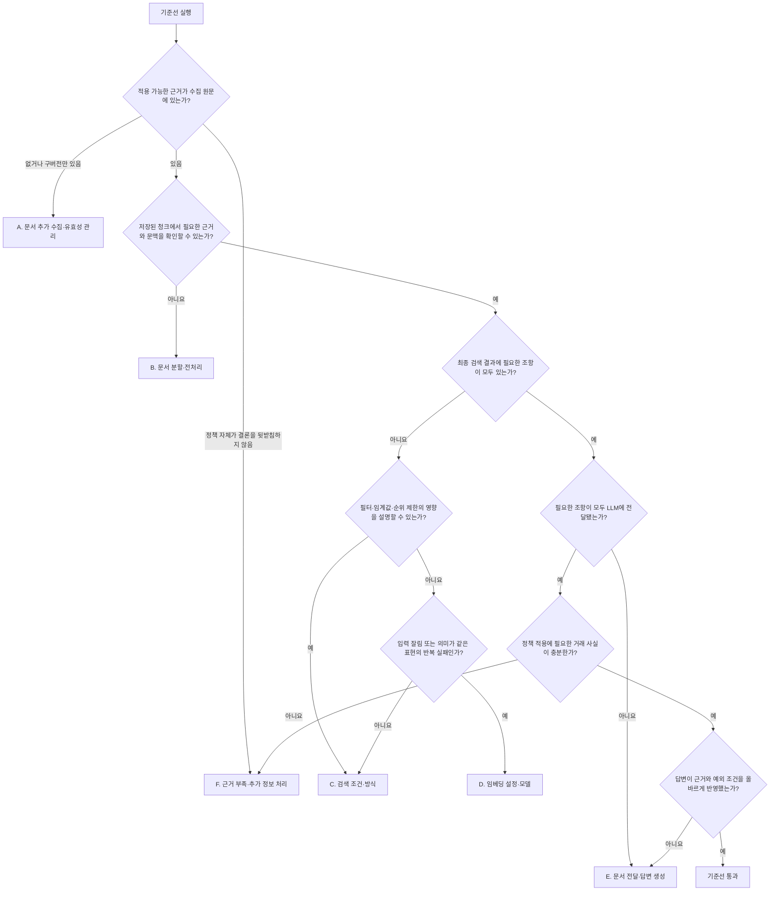

# 정책 RAG 실험 분기 흐름

문의마다 **기대 답변, 필요한 정책 조항과 적용 버전, 문의에 빠진 사실**을 적은 뒤 현재 설정으로 실행한다. 여러 문제가 함께 보이면 흐름도에서 처음 걸린 분기부터 실험한다.

## 1. 어디부터 바꿀지 결정

## 2. 분기별로 바꿀 조건

| 분기 | 관찰 결과 → 첫 실험 | 개선 확인 |
|---|---|---|
| **A. 문서 수집·유효성** | 조항이 누락됐으면 유효한 문서 추가 수집. 구버전이나 중복 문서가 섞였으면 적용일·버전 기록 또는 중복 제거를 각각 비교 | 유효 근거 보유율, 잘못된 버전 사용률 |
| **B. 문서 분할·전처리** | 예외 조항이 제목이나 표 헤더와 분리됐다면 제목·문단 기준 분할, 청크 크기, 겹침을 하나씩 비교 | 필요한 조항 전체가 검색된 문의 비율 |
| **C. 검색 조건·방식** | 근거가 순위 제한이나 임계값에 걸리면 `topK` 또는 `similarityThreshold` 비교. 적용 범위가 틀린 문서가 섞이면 메타데이터 필터 비교. 후보는 충분하지만 순위가 낮으면 재정렬, 상품 코드 같은 정확한 문자열을 놓치면 키워드 결합 비교 | 상위 K개 내 필요 근거 포함률, 무관한 결과 비율, 검색 지연시간 |
| **D. 임베딩 설정·모델** | 입력 잘림이 확인되면 입력 길이·형식 점검. 한국어 표현이나 도메인 용어에서 반복 실패하면 동일 청크로 모델 비교. 인덱스 크기나 지연시간이 목표라면 지원 출력 차원 비교 | 유형별 근거 포함률과 순위, 인덱스 크기, 검색 지연시간 |
| **E. 문서 전달·답변 생성** | 필요한 조항만 LLM에 직접 넣어본다. 답변이 개선되면 전달 순서·길이·중복 처리를 비교한다. 같은 오류가 남으면 일반 규칙과 예외의 적용 지침을 비교한다 | 답변 정확도, 예외 반영률, 인용과 답변의 일치율 |
| **F. 근거 부족·추가 정보 처리** | 정책에 규정이 없으면 판단 보류를, 정책은 있지만 거래 사실이 부족하면 필요한 정보를 요청하는 지침을 실험한다 | 근거 없는 단정 비율, 답변 가능한 문의의 불필요한 보류율 |

모델이나 출력 차원을 변경할 때는 문서와 질의 모두에 같은 설정을 적용한다. 검색 조건을 진단할 때는 최종 답변에 인용된 조항과 실제 검색 후보 및 LLM에 전달한 청크를 구분해 기록한다.

## 3. 적용 예시

> 배송 조회에는 배송 완료로 표시되지만 상품을 받지 못했다. 어떤 증빙을 확인해야 하며 주문 주소로 배송되지 않았다면 환불받을 수 있는가?

기대 답변에는 **배송 증빙 요건**과 **미배송 시 환불 조항**이 모두 들어간다. 실제 배송지 확인 전에는 환불 여부를 조건부로 안내한다.

| 기준선에서 발견한 상황 | 다음 실험 |
|---|---|
| 배송 증빙을 다룬 문서가 적재 대상에서 누락됐다 | **A**. 해당 문서를 추가 적재하고 재실행 |
| 증빙 조항 본문은 있지만 제목이나 적용 조건이 잘렸다 | **B**. 제목과 본문을 유지하는 분할 방식 비교 |
| 증빙 조항이 후보 8위이고 `topK=5`다 | **C**. `topK=10`에서 증빙 조항 회수, 무관한 결과 증가, 지연시간 확인 |
| “배송 완료인데 못 받았다”와 “물건이 도착하지 않았다”에서 증빙 조항이 반복해서 낮게 나온다 | **D**. 같은 청크로 모델을 바꿔 두 표현의 조항 순위 비교 |
| 두 조항이 모두 전달됐는데 답변이 증빙 확인 절차를 생략했다 | **E**. 필요한 두 조항만 전달한 결과와 기준선 비교 |
| 거래 정보에 실제 배송지가 없다 | **F**. 필요한 증빙을 안내하고 환불 여부를 조건부로 답하는지 확인 |

## 4. 실행과 기록

1. 같은 문의 세트와 정책 문서 스냅샷으로 기준선을 실행한다. 검색 후보의 조항 ID·순위·점수, 최종 검색 결과, LLM 전달 내용과 답변을 남긴다.
2. 문의별로 처음 실패한 분기를 기록한다. 분기의 조건 하나를 변경하고, 해당 조건이 문서 수집이면 변경된 문서 목록도 기록한다.
3. 같은 문의 세트로 재실행한다. 목표 유형의 개선 폭, 다른 유형의 성능 변화, 검색 지연시간을 기준선과 비교한다.
4. 개선 이후에도 실패한 문의는 흐름도에 다시 넣는다. 예를 들어 문서를 추가한 뒤에도 검색에서 근거가 빠지면 C 또는 D로 이어간다.

| 문의 | 실패 분기 | 관찰된 근거 | 변경 조건 | 비교 결과 | 다음 분기 |
|---|---|---|---|---|---|
| 배송 완료 표시와 미수령 | C | 배송 증빙 조항 8위 | `topK` 5 → 10 | 실행 후 기록 | 결과에 따라 결정 |

위 표의 순위와 설정 변경은 분기 사용 예시다. 기존 실행 결과는 [정책 RAG 실험 기록](./RAG_EXPERIMENTS.md)에서 확인할 수 있다.
